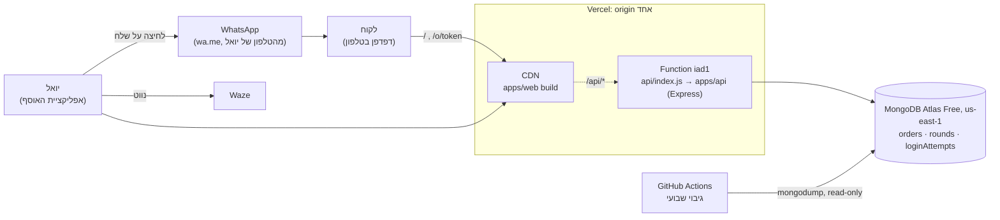
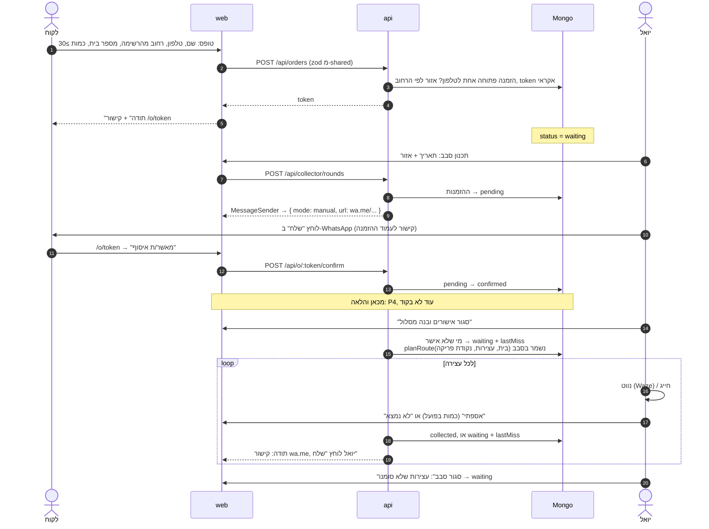
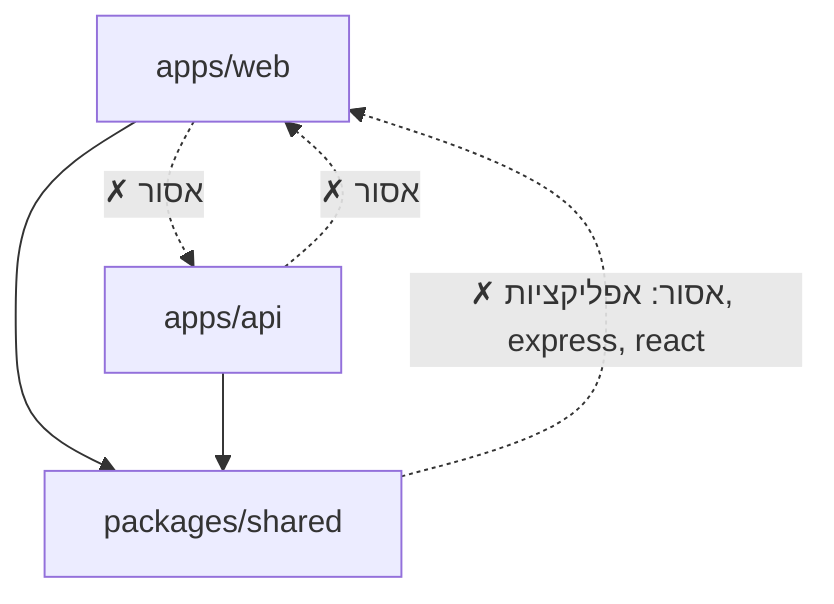

# ארכיטקטורה: BottleRun ("לתת עוד")

> מסכם את `docs/spec.md` ואת `docs/decisions/` (ADRs 0001-0006). איפה שיש סתירה, ה-ADR קובע.
> מצב נוכחי (2026-10-20): P4 בעבודה. קיימים: רשימת הרחובות, הטופס הציבורי, ההתחברות, מסך ההזמנות, הודעות wa.me,
> תכנון סבב ואישורים, עמוד ההזמנה של הלקוח, ה-function ב-Vercel והגיבוי. מה שמסומן _(P4)_ עוד לא קיים בקוד
> (בעיקר: המסלול, "אספתי", סגירת סבב וההיסטוריה).

## רכיבים

| רכיב | מה | איפה | החלטה |
|---|---|---|---|
| **web** | SPA ב-React + Vite. שלושה חלקים: טופס ציבורי (`/`), עמוד הזמנה של הלקוח (`/o/<token>`), אפליקציית האוסף (אחרי התחברות). רק את אפליקציית האוסף אפשר להוסיף למסך הבית (PWA): `manifest.webmanifest`, `icon.svg` (המקור) והאייקונים ב-PNG נמצאים ב-`apps/web/public`, ו-`pwaHead.tsx` מוסיף את התגיות ל-head רק ב-`/login` וב-`/app/*`. בלי service worker. `viewport-fit=cover` ב-`index.html`, וריווח `safe-area` ב-`styles.css`. | `apps/web` | ADR-0001, 0006 |
| **api** | Express. `app.ts` מייצא את `createApp(deps)`, שמקבל את התלויות החיצוניות (repos, בדיקת DB, הגדרות ההתחברות וה-WhatsApp). יש שתי נקודות כניסה דקות, ושתיהן בונות את התלויות האמיתיות עם `depsFromEnv` (`envDeps.ts`: `createMongoDeps` + `authDepsFromEnv` + `messagingDepsFromEnv`): `server.ts` (מקומי / hosting רגיל), ו-`apps/api/src/vercelEntry.ts`, ה-function של Vercel (דרך `createVercelHandler`, שבונה את האפליקציה בבקשה הראשונה). Vercel לא אורז קבצי TS של הריפו, ולכן `npm run build:api` (esbuild) אורז אותו, יחד עם קוד ה-api ו-`packages/shared`, ל-`api/index.js` שנשמר ב-git. רק `express` ו-`mongodb` נשארים חיצוניים. `checks.sh build` נכשל אם החבילה לא מעודכנת. בבדיקות: `createFakeDeps()`. | `apps/api`, `api/index.js` (נוצר) | ADR-0001, 0002 |
| **shared** | קוד TS שנצרך ישירות, בלי build: טיפוסים, סכמות zod, `renderMessage`, קבועים (שווי בקבוק _(P4)_), ורשימת הרחובות עם אזור ונקודה (`data/streets.json`, `searchStreets`, `findStreet`). | `packages/shared` | ADR-0001, 0005 |
| **סקריפט רחובות** | חד-פעמי, לא חלק מהאפליקציה: מוריד את הרשימה מ-data.gov.il (`--refresh-list`) וממלא נקודה ואזור לכל רחוב דרך Nominatim, בקשה בשנייה. אזור לפי `REGION_DIVIDER`. התוצאה נשמרת ב-git. | `scripts/geocode-streets.ts` | ADR-0005 |
| **MongoDB Atlas Free** | אוספים `orders`, `rounds`, `loginAttempts` (TTL). driver רשמי, בלי Mongoose. | AWS us-east-1 | ADR-0001, 0002 |
| **Vercel Hobby** | פרויקט אחד (`latet-od`): ה-build של web ב-CDN, ו-api כ-function ב-`iad1`, ליד Atlas. origin אחד. ה-build, ה-region, ה-rewrites וה-headers ב-`vercel.json`. | `vercel.json` | ADR-0002 |
| **WhatsApp** | `wa.me` עם טקסט מוכן. יואל לוחץ "שלח". מאחורי `MessageSender`. | | ADR-0003 |
| **Waze / חייגן** | `https://waze.com/ul?q=…&navigate=yes`, `tel:`. קישורים בלבד. | | spec §6.4 |
| **גיבוי** | GitHub Actions שבועי (שני 02:17 UTC) ובהפעלה ידנית: `mongodump` עם משתמש read-only, artifact ל-90 יום. מחוץ לאפליקציה. | `.github/workflows/backup.yml` | ADR-0002 |
| **בדיקת smoke** | אחרי כל deploy: כמה GET מול האתר (`/api/health`, 404 של ה-api, תגיות OG, קישור עמוק ל-`/o/...`). לא משנה כלום. | `scripts/smoke.ts` | ADR-0002 |

**אין בזמן ריצה:** geocoding, שירות מסלולים, cron, תורים, או זיכרון משותף בין בקשות. המיקום מגיע מקובץ רחובות סטטי
(OSM, חד-פעמי), וסדר העצירות מחושב בתוך האפליקציה (`planRoute`, קו אוויר) _(P4)_.

## פריסה

- `vercel.json`: `/api/*` עובר ב-rewrite ל-function (`api/index.js`), וכל השאר ל-`index.html`. קובץ שקיים ב-build
  (`/assets/*`, `/og-image.jpg`, `/manifest.webmanifest`, האייקונים) מוגש לפני ה-rewrites. `/o/*` מקבל `X-Robots-Tag: noindex`.
  בגלל ה-origin האחד: בלי CORS, ו-cookie עם `SameSite=Lax`.
- **region:** ה-function ב-`iad1`, ליד Atlas ב-us-east-1. הטופס הסטטי מגיע מה-CDN, ורק קריאות ל-api חוצות את האוקיינוס.
- **warm-up:** הטופס שולח `GET /api/health` כשהוא נטען. עד שהלקוח מסיים למלא, ה-function כבר חם.
- בפיתוח: Vite ב-5173 מעביר את `/api` ל-Express ב-3000. אותו מבנה, אותו origin.
- **deploy:** push ל-`main` (באישור בלבד). הצעדים הידניים והבדיקות (משתני סביבה, Atlas, secret של הגיבוי, אבטחה,
  cold start, rollback): `docs/deploy.md`. אחרי כל deploy: `npm run smoke -- https://latet-od.vercel.app` (`scripts/smoke.ts`).
  הגיבוי: `.github/workflows/backup.yml`.

## זרימת הזמנה

הסטטוסים ומעברי הסטטוס: spec §4. בכל שלב עד `collected` הלקוח יכול לבטל או לשנות מעמוד ההזמנה (כפתורים, POST).

## גבולות בין workspaces

| מ- | מותר לייבא | אסור | נאכף ב- |
|---|---|---|---|
| `apps/web` | `@bottlerun/shared`, React, ספריות דפדפן | `apps/api` | ESLint `no-restricted-imports` |
| `apps/api` | `@bottlerun/shared`, Express, driver של Mongo | `apps/web` | ESLint `no-restricted-imports` |
| `packages/shared` | zod, קוד TS טהור | כל אפליקציה, `express`, `react` | ESLint `no-restricted-imports` |
| `scripts` | `@bottlerun/shared`, Node | כל אפליקציה | ESLint `no-restricted-imports` |
| `api` (ה-function של Vercel) | `apps/api`, Node | `apps/web` | ESLint `no-restricted-imports` |

**מה שייך ל-shared:** כל דבר ששני הצדדים צריכים להסכים עליו: צורת ההזמנה (zod), קודי סטטוס, כללי validation
(טלפון ישראלי, מינימום 30), טקסט ההודעות (`renderMessage`), רשימת הרחובות, ושווי בקבוק.
**מה לא שייך:** גישה ל-DB, סודות, ונקודת ההתחלה (הבית של יואל).

## ממשקים מול העולם החיצון

כל אחד עם fake לבדיקות, כך שהבדיקות לא נוגעות ברשת ולא ב-Atlas:

| ממשק | מימוש אמיתי | fake | ADR |
|---|---|---|---|
| `MessageSender` | `WaMeLinkSender` (MVP), `CloudApiSender` (אם יואל יבחר אוטומטי) | `FakeSender` | 0003 |
| `OrdersRepo`, `RoundsRepo` | MongoDB | בזיכרון | 0001 |
| `AttemptStore` (הגבלת ניסיונות וקצב) | `loginAttempts` ב-Mongo, TTL | בזיכרון | 0004 |
| `DistanceMatrix` _(P4)_ | haversine (פונקציה טהורה). OSRM אם יידרש. | haversine | 0005 |

## אבטחה ופרטיות (תקציר)
- עמוד הלקוח: רק עם token אקראי וארוך, אישור וביטול ב-POST (ה-preview של WhatsApp שולח GET).
- האוסף: סיסמה אחת (scrypt hash ב-env), cookie חתום ל-90 יום שמתחדש, בדיקת `Origin` בכל פעולה שמשנה משהו.
- הגבלת קצב ב-Mongo, כי ב-serverless אין זיכרון משותף. הזמנה פתוחה אחת לטלפון, ושדה honeypot.
- בלי תוכן בקשות בלוגים: הלוגים של ה-api רושמים את תבנית ה-route, לא את ה-path. סודות ב-env בלבד (ב-Vercel:
  Environment Variables). ה-request logs של Vercel עצמו כן רושמים כל path, כולל `/o/<token>` (ראה `docs/deploy.md`).

## בדיקות ו"ירוק"
`bash .claude/checks.sh all`: lint (כולל הגבולות), format, types, sec, test, build. פירוט ב-`CLAUDE.md`.
מחוץ לירוק, ידני: ה-deploy, ה-smoke מול האתר האמיתי, בדיקות האבטחה וה-cold start (`docs/deploy.md`).
