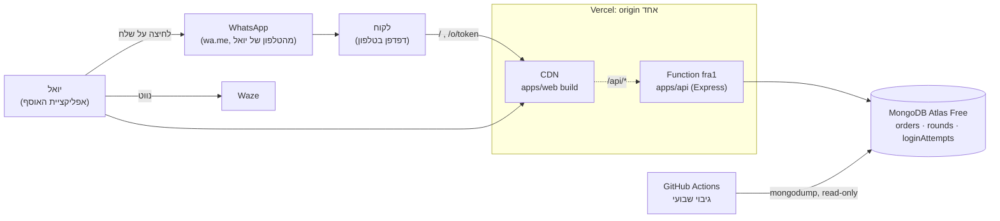
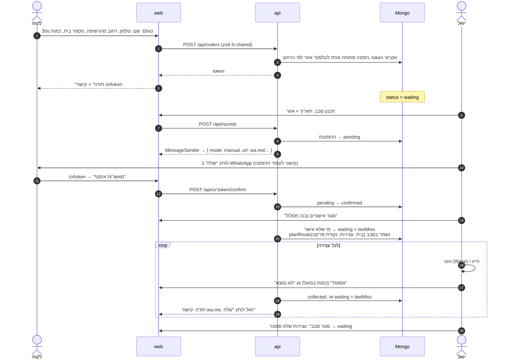
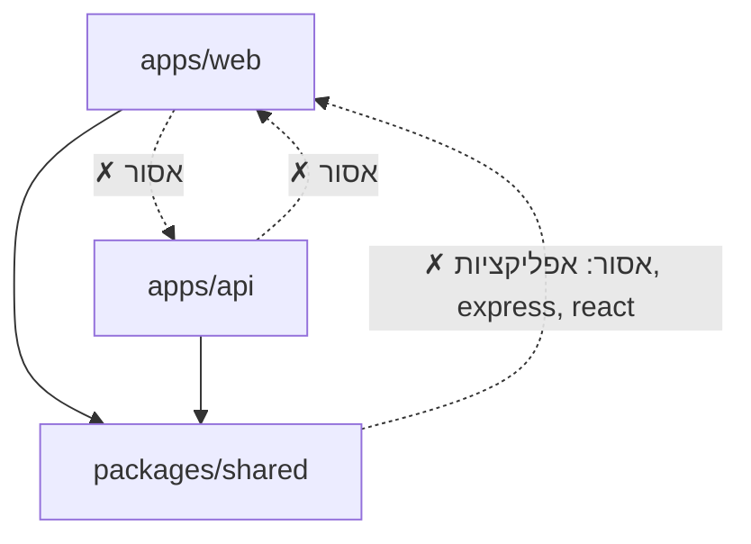

# ארכיטקטורה: BottleRun ("לתת עוד")

> מסכם את `docs/spec.md` ואת `docs/decisions/` (ADRs 0001-0005). איפה שיש סתירה, ה-ADR קובע.
> מצב נוכחי: שלד בלבד (P3). מה שמסומן _(P4)_ עוד לא קיים בקוד.

## רכיבים

| רכיב | מה | איפה | החלטה |
|---|---|---|---|
| **web** | SPA ב-React + Vite. שלושה חלקים: טופס ציבורי (`/`), עמוד הזמנה של הלקוח (`/o/<token>`), אפליקציית האוסף (אחרי התחברות). | `apps/web` | ADR-0001 |
| **api** | Express. `app.ts` מייצא את האפליקציה, ויש שתי נקודות כניסה דקות: `server.ts` (מקומי / hosting רגיל), ו-function ל-Vercel _(P4)_. | `apps/api` | ADR-0001, 0002 |
| **shared** | קוד TS שנצרך ישירות, בלי build: טיפוסים, סכמות zod, `renderMessage`, קבועים (שווי בקבוק), ורשימת הרחובות עם אזור ונקודה (`data/streets.json`, `searchStreets`, `findStreet`). | `packages/shared` | ADR-0001, 0005 |
| **סקריפט רחובות** | חד-פעמי, לא חלק מהאפליקציה: מוריד את הרשימה מ-data.gov.il (`--refresh-list`) וממלא נקודה ואזור לכל רחוב דרך Nominatim, בקשה בשנייה. אזור לפי `REGION_DIVIDER`. התוצאה נשמרת ב-git. | `scripts/geocode-streets.ts` | ADR-0005 |
| **MongoDB Atlas Free** | אוספים `orders`, `rounds`, `loginAttempts` (TTL). driver רשמי, בלי Mongoose. | אירופה | ADR-0001 |
| **Vercel Hobby** | פרויקט אחד: ה-build של web ב-CDN, ו-api כ-function ב-`fra1`. origin אחד. | | ADR-0002 |
| **WhatsApp** | `wa.me` עם טקסט מוכן. יואל לוחץ "שלח". מאחורי `MessageSender`. | | ADR-0003 |
| **Waze / חייגן** | `https://waze.com/ul?q=…&navigate=yes`, `tel:`. קישורים בלבד. | | spec §6.4 |
| **גיבוי** | GitHub Actions שבועי: `mongodump` עם משתמש read-only, artifact ל-90 יום. מחוץ לאפליקציה. _(P4)_ | | ADR-0002 |

**אין בזמן ריצה:** geocoding, שירות מסלולים, cron, תורים, או זיכרון משותף בין בקשות. המיקום מגיע מקובץ רחובות סטטי
(OSM, חד-פעמי), וסדר העצירות מחושב בתוך האפליקציה (`planRoute`, קו אוויר).

## פריסה

- `/api/*` עובר ב-rewrite ל-function, וכל השאר ל-`index.html`. בגלל ה-origin האחד: בלי CORS, ו-cookie עם `SameSite=Lax`.
- **warm-up:** הטופס שולח `GET /api/health` כשהוא נטען. עד שהלקוח מסיים למלא, ה-function כבר חם.
- בפיתוח: Vite ב-5173 מעביר את `/api` ל-Express ב-3000. אותו מבנה, אותו origin.

## זרימת הזמנה

הסטטוסים ומעברי הסטטוס: spec §4. בכל שלב עד `collected` הלקוח יכול לבטל או לשנות מעמוד ההזמנה (כפתורים, POST).

## גבולות בין workspaces

| מ- | מותר לייבא | אסור | נאכף ב- |
|---|---|---|---|
| `apps/web` | `@bottlerun/shared`, React, ספריות דפדפן | `apps/api` | ESLint `no-restricted-imports` |
| `apps/api` | `@bottlerun/shared`, Express, driver של Mongo | `apps/web` | ESLint `no-restricted-imports` |
| `packages/shared` | zod, קוד TS טהור | כל אפליקציה, `express`, `react` | ESLint `no-restricted-imports` |
| `scripts` | `@bottlerun/shared`, Node | כל אפליקציה | ESLint `no-restricted-imports` |

**מה שייך ל-shared:** כל דבר ששני הצדדים צריכים להסכים עליו: צורת ההזמנה (zod), קודי סטטוס, כללי validation
(טלפון ישראלי, מינימום 30), טקסט ההודעות (`renderMessage`), רשימת הרחובות, ושווי בקבוק.
**מה לא שייך:** גישה ל-DB, סודות, ונקודת ההתחלה (הבית של יואל).

## ממשקים מול העולם החיצון

כל אחד עם fake לבדיקות, כך שהבדיקות לא נוגעות ברשת ולא ב-Atlas:

| ממשק | מימוש אמיתי | fake | ADR |
|---|---|---|---|
| `MessageSender` | `WaMeLinkSender` (MVP), `CloudApiSender` (אם יואל יבחר אוטומטי) | `FakeSender` | 0003 |
| `OrdersRepo`, `RoundsRepo` | MongoDB | בזיכרון | 0001 |
| `AttemptStore` (הגבלת ניסיונות וקצב) | `loginAttempts` ב-Mongo, TTL | בזיכרון | 0004 |
| `DistanceMatrix` | haversine (פונקציה טהורה). OSRM אם יידרש. | haversine | 0005 |

## אבטחה ופרטיות (תקציר)
- עמוד הלקוח: רק עם token אקראי וארוך, אישור וביטול ב-POST (ה-preview של WhatsApp שולח GET).
- האוסף: סיסמה אחת (scrypt hash ב-env), cookie חתום ל-90 יום שמתחדש, בדיקת `Origin` בכל פעולה שמשנה משהו.
- הגבלת קצב ב-Mongo, כי ב-serverless אין זיכרון משותף. הזמנה פתוחה אחת לטלפון, ושדה honeypot.
- בלי תוכן בקשות בלוגים. סודות ב-env בלבד.

## בדיקות ו"ירוק"
`bash .claude/checks.sh all`: lint (כולל הגבולות), format, types, sec, test, build. פירוט ב-`CLAUDE.md`.
