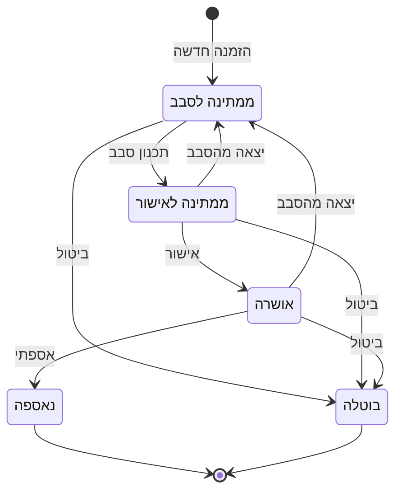

# אפיון v2: "לתת עוד", אפליקציית איסוף בקבוקים

> מחליף את אפיון v1 (`מסמך אפיון- אפליקציית איסוף בקבוקים.docx`). מבוסס על v1, על תשובות יואל (`docs/friend-answers.md`)
> ועל בדיקות ההיתכנות (`docs/spikes/results.md`). עודכן: 2026-10-19, אחרי red-team.
>
> **מקרא:**
> - 🔄 = שינוי מ-v1, כולל הסיבה.
> - **(ת7)** = תשובת יואל לשאלה 7.
> - 💡 = הצעה או אילוץ שלנו (המפתח), לא בקשה של יואל.
> - ⏳ = פתוח. ייקבע ב-P2 או אחרי תשובה של יואל (ראה סעיף 8).

## 0. מה השתנה בקצרה
- **אין איסוף יומי.** יואל אוסף לפי הזמינות שלו. **השאיפה** שלו: לחלק את העיר לשני חצאים ולאסוף פעמיים בשבוע (ת2, ת17).
  לכן במקום "סגור הזמנות למחר" יש **סבב**: תאריך + חצי עיר.
- **הכתובת נבחרת מרשימת הרחובות הרשמית,** והאזור נקבע לפי הרחוב. 💡 בלי כרטיס אשראי (אילוץ שלנו).
- **לינק אישור בטוח.** עמוד עם כפתור ו-token אקראי, במקום לינק שמאשר ברגע שנפתח.
- **יותר שליטה.** הלקוח יכול לבטל ולשנות, יואל יכול להוסיף הזמנה, ולקוח חוזר לא ממלא הכול מחדש.
- **סטטוסים.** נוסף "בוטלה", ונשמרת הסיבה כשהזמנה יוצאת מסבב. הסטטוס Archived הוסר.
- ⏳ **אופן שליחת ה-WhatsApp פתוח:** אוטומטי, או שהאפליקציה מכינה ויואל לוחץ "שלח". נבדוק עלויות ב-P2 ונשאל את יואל.

---

## 1. מטרה והיקף

**מטרה:** להחליף תיאום ידני בתהליך פשוט. לקוח מזמין איסוף בטופס, יואל מתכנן סבב, הלקוחות מאשרים ב-WhatsApp,
ויואל נוסע לפי רשימה מסודרת.

**הפרויקט:** "לתת עוד". אוסף יחיד (יואל), בבית שמש. הכסף מממן תפילין לנערי בר מצווה ולחיילים.
נפח: כ-5 איסופים ביום איסוף, 10 ויותר בשבוע (ת1).

**התהליך.** 📱 WhatsApp · 🌐 אתר (בלי התקנה) · 📋 האפליקציה של יואל (עם סיסמה, אפשר להוסיף למסך הבית כ-PWA: ADR-0006) · 🚗 Waze

1. 📱 הלקוח רואה את הפלאייר בקבוצה ולוחץ על הלינק.
2. 🌐 ממלא טופס קצר: שם, טלפון, רחוב (מרשימה), מספר בית, איפה הבקבוקים, כמה בקבוקים (לפחות 30).
3. 🌐 רואה "תודה, קיבלנו". המערכת יודעת את חצי העיר לפי הרחוב.
4. 📋 ההזמנה מופיעה ברשימה של יואל, יחד עם ההזמנות מאותו חצי עיר.
5. 📋 יואל מתכנן סבב: בוחר תאריך וחצי עיר.
6. 📱 הלקוח מקבל הודעה: "נגיע ביום X. לאישור לחץ כאן."
7. 🌐 בעמוד ההזמנה לוחץ "מאשר". מי שלא אישר לא נכנס לסבב הזה ומחכה לסבב הבא.
8. 📋 ביום הסבב יואל פותח רשימה מסודרת של מי שאישר: מהבית עד נקודת הפריקה (נחל נחשון 7).
9. 🚗 בכל כתובת: "נווט" פותח את Waze. 📞 "חייג" אם צריך.
10. 📋 "אספתי", ו-📱 הלקוח מקבל הודעת תודה. או "לא נמצא", וההזמנה חוזרת לחכות לסבב הבא.
11. 📋 "סיימתי את הסבב". הבקבוקים נספרים בסטטיסטיקה של החודש.

בכל שלב הלקוח יכול לבטל דרך עמוד ההזמנה שלו (🌐).

**ב-MVP:** טופס ציבורי, עמוד הזמנה אישי ללקוח, אפליקציית אוסף (הזמנות, סבבים ומסלול, היסטוריה), הודעות WhatsApp,
סטטיסטיקה חודשית.

**טכנולוגיה:** נקבעת ב-ADRs (P2). הכיוון הוא TypeScript, React, Express ו-MongoDB, כמו ב-v1.

**מחוץ ל-MVP:**
- סינון הודעות בשבת ובחג (הוחלט: overkill).
- לקוחות בלי WhatsApp (טלפון כשר). נדחה לעתיד, אבל המבנה מוכן: אופן יצירת הקשר נשמר בכל הזמנה.
- יותר מאוסף אחד, הרשאות, ערים או אזורים נוספים.
- תזכורות ופעולות מתוזמנות (cron).
- מפה במסך המסלול. יש רשימה, ו-Waze עושה את הניווט.
- עדכונים לקבוצת ה-WhatsApp של המשפחות. ממשיכים ידנית, כמו היום.
- אפליקציה להתקנה (native; את אפליקציית האוסף מוסיפים למסך הבית כ-PWA, ADR-0006), שפות נוספות, תשלומים וקבלות.
- סבב של יותר מ-25 עצירות.

---

## 2. משתמשים

| משתמש | מי | מה חשוב לו |
|---|---|---|
| **לקוח** | תורם בקבוקים. רוב הלקוחות מבוגרים (ת9). מגיע מהפלאייר בקבוצות WhatsApp, ומשתמש בטלפון. | טופס קצר, טקסט וכפתורים גדולים, בלי הרשמה, לא למלא שוב בפעם הבאה. |
| **יואל (האוסף)** | משתמש יחיד. | מעט לחיצות, עבודה מהטלפון בזמן הסבב. 💡 תשובות הלקוחות מגיעות אליו, ולא הולכות לאיבוד בשרת. |

---

## 3. מסכים

### ציבוריים (בלי התחברות)

#### 3.1 טופס הזמנה (`/`)
בראש העמוד: "לתת עוד" והסלוגן. הלקוח לא בוחר עיר ולא בוחר אזור.

| שדה | חובה | הערות |
|---|---|---|
| שם | כן | |
| טלפון נייד | כן | ישראלי (05X, 10 ספרות). מקלדת מספרים. |
| רחוב | כן | בחירה מרשימת הרחובות של בית שמש. החיפוש מתאים לכל מילה: "רבין" מוצא "דרך רבין יצחק". אם הרחוב חסר: "הרחוב שלי לא ברשימה", וכותבים חופשי. |
| מספר בית | כן | אפשר עם אות (12א). |
| איפה הבקבוקים | כן | בכניסה לבית פרטי / בבניין - ליד דלת הדירה / למטה בכניסה לבניין. |
| קומה ודירה | כשנבחר "בבניין - ליד דלת הדירה" | שורה אחת חופשית, למשל "כניסה ב', קומה 3, דירה 12". |
| הערה | לא | למשל "ליד השער", "קוד לבניין". |
| כמות בקבוקים | כן | **מינימום 30.** חוק נוקשה (ת8). |

- 🔄 _רחוב: v1 השתמש ב-Google Places Autocomplete. הוחלף כי הוא דורש כרטיס אשראי (💡 אילוץ שלנו). הרשימה הרשמית חינמית.
  לא בדקנו שהיא כוללת את כל הרחובות החדשים, ולכן יש "לא ברשימה"._
- 🔄 _"איפה הבקבוקים" ו"קומה ודירה": חדשים. יש כל סוגי הבתים, ובבניינים חלק מורידים וחלק צריך לעלות (ת4).
  שאלה אחת ושורה אחת, ולא שישה שדות, כי רוב הלקוחות מבוגרים (ת9)._
- 🔄 _הצ'קבוקס "הכנתי לפחות 30 בקבוקים" הוסר. שדה הכמות כבר אוכף 30._

התנהגות:
- **לקוח חוזר:** הדפדפן זוכר את הפרטים וממלא אותם מראש. בנוסף, בהודעת התודה יש לינק "הזמנה חוזרת" (ראה 3.3).
  🔄 _חדש (ת9)._
- **טלפון שכבר יש לו הזמנה פתוחה:** לא נפתחת הזמנה שנייה. מוצגת הודעה: "כבר יש הזמנה פתוחה למספר הזה."
  לא שולחים הודעה למספר, כי כל אחד יכול להקליד מספר של מישהו אחר.
- שורת פרטיות קצרה: "הפרטים משמשים רק לתיאום האיסוף".

#### 3.2 מסך תודה
"תודה! קיבלנו את ההזמנה. לפני הסבב באזור שלך נשלח לך הודעת WhatsApp לאישור."
וכפתור "לצפייה בהזמנה או לביטול", שמוביל לעמוד ההזמנה (3.3).

🔄 _v1: "יום לפני האיסוף". אין איסוף יומי, ולכן ההודעה נשלחת כשמתוכנן סבב באזור._

#### 3.3 עמוד ההזמנה של הלקוח (`/o/<token>`)
עמוד אחד לכל הזמנה. מגיעים אליו ממסך התודה ומהלינקים ב-WhatsApp. מה שמוצג תלוי בסטטוס:

| סטטוס | מה הלקוח רואה |
|---|---|
| ממתינה לסבב | פרטי ההזמנה, **שינוי**, **ביטול**. |
| ממתינה לאישור | תאריך הסבב, כפתור גדול **"כן, אוציא את הבקבוקים ב-DD/MM"** (מאשר שהלקוח מוציא את הבקבוקים), כפתור "לא מתאים הפעם" 💡, שינוי, ביטול. |
| אושרה | "נתראה ב-<תאריך>", שינוי, ביטול. |
| נאספה / בוטלה | תודה, וכפתור **"הזמנה חדשה עם אותם פרטים"**. |

- אישור וביטול הם כפתורים (POST), לא פתיחה של לינק. לחיצה כפולה לא מזיקה.
- אפשר לשנות כתובת, כמות והערה. לא את הטלפון.
- שינוי כתובת אחרי שההזמנה נכנסה לסבב מוציא אותה מהסבב.
- אישור אחרי שיואל סגר את האישורים: "האישור נסגר. נחזור אליך עם מועד חדש."
- 🔄 _v1: לינק `confirm/ID_123` שמאשר ברגע שנפתח. הוחלף משתי סיבות. ראשית, WhatsApp פותח את הלינק כדי לבנות preview
  (בקשת GET, כבר אצל השולח), ולכן לינק כזה "מאשר" לבד. שנית, את ה-ID אפשר לנחש. token אקראי וכפתור פותרים את שתיהן._
- 🔄 _ביטול ושינוי עצמי (ת7), הזמנה חוזרת (ת9): חדשים. "לא מתאים הפעם" הוא הצעה שלנו 💡; אפשר לוותר עליו._

### אפליקציית האוסף (אחרי התחברות)
ניווט תחתון: **הזמנות | סבבים | היסטוריה**.

#### 3.4 התחברות
סיסמה. החיבור נשמר לזמן ארוך, כדי שלא יתנתק באמצע סבב.

#### 3.5 הזמנות
- ההזמנות שממתינות לסבב, בקבוצות: **רמת בית שמש**, **בית שמש**, ו**בלי אזור** (רחוב שנכתב חופשי, יואל משייך ידנית).
  לכל אזור: מספר הזמנות וסך הבקבוקים.
- תג על הזמנה שחזרה מסבב, למשל "לא אישר · 12/11".
- פעולות על הזמנה: עריכה, שינוי אזור, ביטול.
- **"הוספת הזמנה"** ללקוח שהתקשר: אותו טופס ואותם כללים.
  🔄 _חדש (ת19)._
- **"תכנון סבב":** בוחרים תאריך ואזור. כל ההזמנות שממתינות באותו אזור מסומנות, ואפשר להוריד סימון.
  אפשר להוסיף טקסט אישי (לא חובה, ת11). לוחצים "שלח בקשות אישור".
  🔄 _v1: "סגור הזמנות למחר". הוחלף כי אין איסוף יומי: יואל אוסף לפי זמינות, והשאיפה היא חצי עיר בכל סבב (ת2, ת17)._

#### 3.6 סבב
**שלב 1: אישורים**
- מי אישר, מי עוד לא, ומי ביקש מועד אחר.
- **"אישר בשיחה או בהודעה":** יואל מסמן ידנית לקוח שאישר בשיחה או בתשובה ב-WhatsApp.
- **"התחל מסלול":** מי שלא אישר יוצא מהסבב וחוזר לחכות (ת5). המערכת מסדרת את העצירות:
  מהבית ← העצירות ← נקודת הפריקה (ת3, ת16). ⏳ איך מחשבים את הסדר נקבע ב-P2 (ראה 6.3).
  🔄 _v1: המסלול חושב בכל פתיחה של המסך, בלי נקודות התחלה וסיום. עכשיו הוא מחושב פעם אחת ונשמר, כדי שהסדר לא ישתנה
  באמצע הנסיעה._

**שלב 2: מסלול.** כרטיס לכל עצירה, לפי הסדר:
- שם, כתובת מלאה (איפה הבקבוקים, קומה ודירה, הערה), כמות משוערת.
- כפתורים: **נווט** (Waze), **חייג**, **אספתי**, **לא נמצא**. כרטיס שטופל נצבע ויורד לסוף הרשימה.
- אפשר להזיז עצירה למעלה או למטה ידנית.
- **"אספתי":** אפשר לתקן את מספר הבקבוקים (ברירת המחדל היא הכמות מההזמנה). נשלחת ללקוח הודעת תודה.
- **"לא נמצא"** 💡: ההזמנה חוזרת לחכות לסבב הבא. (ת6: יואל מתקשר ללקוח ומנסה לתפוס אותו. הסימון עצמו הוא הצעה שלנו.)
- 🔄 _Waze: v1 השתמש ב-`waze://`, שלא עובד טוב באייפון. עכשיו: `https://waze.com/ul?q=<כתובת>&navigate=yes`, לפי הכתובת הכתובה._
- 🔄 _"לא נמצא" ותיקון הכמות: חדשים. תיקון הכמות משרת את הסטטיסטיקה (ת12)._

**"סיימתי את הסבב":** עצירות שלא סומנו חוזרות לחכות. כל עוד הסבב עוד באישורים (לפני "התחל מסלול") אותו כפתור נקרא "בטל את הסבב", ואז כל הלקוחות בסבב חוזרים לחכות.
🔄 _v1: "סגור יום" העביר הזמנות ל-Archived. הסטטוס הזה הוסר: הסבב הסגור הוא מה שמנקה את המסך, ו"נאספה" כבר סטטוס סופי._

#### 3.7 היסטוריה וסטטיסטיקה
- בראש המסך, לחודש שנבחר: **בקבוקים שנאספו**, **מספר כתובות שנאספו**, **שווי** (בקבוקים × 20 אג') (ת12).
- מתחת: רשימת ההזמנות שנסגרו באותו חודש.
- 🔄 _v1 הציע מונה בקבוקים "בעתיד". עכשיו זה חלק מה-MVP, יחד עם מספר הכתובות והשווי (ת12)._

#### 3.8 הגדרות
שווי לבקבוק (20 אג'), כתובת ההתחלה וכתובת הסיום. ⏳ מסך באפליקציה, או ערכים בקובץ ההגדרות של השרת. ייקבע ב-P2.

---

## 4. מחזור חיי הזמנה

### סטטוסים

| קוד | בעברית | מתי | ב-v1 |
|---|---|---|---|
| `waiting` | ממתינה לסבב | נוצרה, או חזרה מסבב שלא הצליח | New |
| `pending` | ממתינה לאישור | בסבב, ונשלחה בקשת אישור | Pending_Confirmation |
| `confirmed` | אושרה | הלקוח אישר, או שיואל סימן "אישר בשיחה או בהודעה" | Confirmed |
| `collected` | נאספה | יואל לחץ "אספתי". סופי. | Collected |
| `cancelled` | בוטלה | הלקוח או יואל ביטלו. סופי. | (לא היה) |

🔄 _New הפך ל-`waiting`, כי הזמנה חוזרת לכאן גם אחרי סבב שלא הצליח, ו"חדשה" מטעה. Archived הוסר (ראה 3.6). `cancelled` נוסף (ת7)._

### יציאה מסבב
הזמנה שיוצאת מסבב בלי שנאספה חוזרת ל"ממתינה לסבב". נשמרים התאריך והסיבה, ומוצגים כתג:
לא אישר בזמן, ביקש מועד אחר, לא נמצא במקום, לא הגענו אליו, או ששינה כתובת.

🔄 _"לא אישר" חסר ב-v1. לפי ת5, מי שלא אישר יוצא מהסבב ומתאמים לו מועד חדש. הוא נשמר כסיבה ולא כסטטוס, כי ההזמנה לא
נתקעת: היא מחכה לסבב הבא. ⏳ כמה סיבות לשמור (אחת או כמה) ייקבע ב-P4._

### מצבי סבב
סבב פתוח (נשלחו בקשות, ואחר כך נבנה מסלול) ← סבב סגור.
- הזמנה נמצאת בסבב פתוח אחד לכל היותר.

---

## 5. מודל נתונים
MongoDB, ברמת המושגים. ⏳ הטיפוסים המדויקים ייקבעו ב-P3 וב-P4, ושם גם נבדוק אם אפשר לפשט
(למשל בלי `customers` ו-`users` נפרדים).

🔄 _v1 הגדיר רק שדה `status`. נוספו סבבים ולקוחות חוזרים, ולכן נוסף מבנה._

**`orders`: הזמנות**

| שדה | הערה |
|---|---|
| `contact` | שם, טלפון, `method` (ב-MVP תמיד `whatsapp`). |
| `address` | `streetCode` + `streetName` (מהרשימה, או טקסט חופשי), `houseNumber`, `bottlesSpot`, `floorApt`, `note`. |
| `bottlesEstimated` | 30 ומעלה. |
| `bottlesCollected` | יואל ממלא ב"אספתי". |
| `status` | ראה סעיף 4. |
| `region` | `ramat` (רמת בית שמש) או `old` (בית שמש). נקבע לפי הרחוב. ריק לרחוב שנכתב חופשי, עד שיואל משייך. |
| `location` | ⏳ נקודה על המפה לסידור העצירות. המקור ייקבע ב-P2 (ראה 6.2). |
| `token` | אקראי וארוך. משמש ללינק של הלקוח. |
| `roundId` | הסבב הנוכחי, אם יש. |
| `lastMiss` | הסבב האחרון שלא הצליח: תאריך וסיבה (סעיף 4). |
| `source` | `form` או `collector`. |
| תאריכים | `createdAt`, `updatedAt`, `collectedAt`, `cancelledAt`. |

**`rounds`: סבבים.** `date`, `region`, `status` (פתוח / סגור), `personalText`, סדר העצירות, `createdAt`, `closedAt`.

**קבצים סטטיים בריפו:** רשימת הרחובות (data.gov.il), ולכל רחוב: האזור שלו, ואולי גם נקודה על המפה (⏳ 6.2).

---

## 6. אינטגרציות חיצוניות

### 6.1 WhatsApp
**הודעות:**
1. **בקשת אישור**: בתכנון סבב. תאריך, לינק, וטקסט אישי אם נכתב (ת11).
2. **תודה**: ב"אספתי". "הזמנתכם נאספה! תודה רבה שלקחתם חלק בלתת עוד!", ולינק להזמנה חוזרת.
3. ⏳ **"קיבלנו"** אחרי כל הזמנה: תלוי באופן השליחה. יש בה סיכון: כל אחד יכול להקליד בטופס מספר של מישהו אחר.

בערך 2-3 הודעות להזמנה, כלומר כ-90-150 בחודש (ת1).

⏳ **אופן השליחה פתוח.** נבדוק ב-P2 מה חינם ומה עולה כסף, ואז נשאל את יואל:
- **אוטומטי:** ממספר נפרד. ת11: "אוטומטי לגמרי". ת18: יואל מסכים למספר נפרד ושואל מה זה דורש ממנו.
  ידוע כבר: WhatsApp Cloud API דורש אמצעי תשלום, ומשלמים על כל הודעה שהעסק יוזם. זה מתנגש עם "בלי כרטיס" 💡.
  לא ברור אם תשובות הלקוחות יגיעו לוואטסאפ של יואל.
- **האפליקציה מכינה, יואל לוחץ "שלח":** לינק wa.me עם טקסט מוכן, מהמספר שלו (ת10: "כרגע המספר האישי שלו").
  חינם, ותשובות מגיעות אליו. בערך 10 לחיצות לסבב.
- **משולב:** מתחילים בלחיצה, ועוברים לאוטומטי אם זה מציק.

**בכל מקרה:**
- הקוד מדבר רק עם ממשק `MessageSender`, כך שאפשר להחליף אופן שליחה בלי לבנות מחדש.
- 💡 תשובות של לקוחות צריכות להגיע ליואל, ולא ללכת לאיבוד בשרת.
- אי אפשר לשלוח הודעה אחת לכולם, כי הלינק אישי לכל לקוח.

🔄 _v1: Green-API (שירות לא רשמי). ההחלטה נדחתה, כי יואל רוצה דרך רשמית שלא תיחסם (ת18)._

### 6.2 אזור ומיקום
**אזור:** לפי הרחוב. מכינים פעם אחת טבלה: לכל רחוב ברשימה, לאיזה חצי עיר הוא שייך. מכינים אותה עם יואל.
רחוב שנכתב חופשי משויך ידנית על ידי יואל.

**מיקום (בשביל סידור העצירות):** ⏳ ייקבע ב-P2. שתי אפשרויות:
- **נקודה לכל רחוב,** שמחושבת פעם אחת ונשמרת בטבלה. בלי קריאות בזמן ריצה. ב-OSM כל 15 הכתובות שנבדקו נמצאו בבית שמש.
- **איתור לכל הזמנה** דרך Google (Apps Script), עם בדיקה שהתוצאה בבית שמש וגיבוי OSM.

**לקח מבדיקת ההיתכנות:** Google שלח את "נחל זוהר 30" למודיעין, וזה הוסיף כ-80 ק"מ למסלול.
`setRegion('il')` לא מנע את זה. `setBounds` רק נותן עדיפות לאזור ולא מגביל אליו, והוא לא נבדק.

🔄 _v1: Google Places בטופס, בלי בדיקה. הוחלף: האזור לפי הרחוב, והמיקום ייקבע ב-P2._

### 6.3 סידור העצירות
⏳ ייקבע ב-P2. שתי אפשרויות:
- **חישוב בתוך האפליקציה:** עם כ-5 עצירות יש 120 סדרים אפשריים, כך שאפשר לבדוק את כולם. בלי שירות חיצוני.
- **Google DirectionFinder דרך Apps Script:** נבדק ידנית בעורך של Apps Script, עד 25 עצירות (חלקן כתובות מומצאות).
  לא נבדק: קריאה מהשרת ל-Apps Script, איך מאבטחים אותה, וכמה זמן היא לוקחת.
  מכסה לחשבון רגיל: 1,000 בקשות ביום, הרבה יותר ממה שצריך.

בשתי האפשרויות יואל יכול להזיז עצירות ידנית, ו-Waze מנווט לכל כתובת לפי הטקסט שלה.

🔄 _v1: Google Directions API ישירות. דורש כרטיס אשראי (💡 אילוץ שלנו)._

### 6.4 שונות
- **רשימת רחובות:** data.gov.il, 461 רשומות לבית שמש. נשמרת כקובץ סטטי בריפו ומתרעננת ידנית מדי פעם.
- **Waze** (`https://waze.com/ul?...`) ו**חייגן** (`tel:`).
- **לינק לטופס** עם preview יפה (כותרת ותמונה בצבעי הפלאייר). הפלאייר מסתובב כתמונה ב-WhatsApp (ת14),
  ואי אפשר ללחוץ על לינק שנמצא בתוך תמונה. לכן הלינק צריך להופיע בטקסט שנשלח עם התמונה.
  💡 קוד QR רק אם מדפיסים את הפלאייר.

---

## 7. דרישות לא-פונקציונליות

**עלות.** יואל: "השאיפה אפס. אם צריך, עד 50 ש"ח בחודש, ועדיף עד 30" (ת15). הסכום כולל hosting והודעות.
💡 אילוץ שלנו: בלי כרטיס אשראי, כשאפשר.

**עברית ו-RTL.** כל הממשק בעברית ומימין לשמאל. טלפונים ומספרים מוצגים משמאל לימין בתוך הטקסט.
תאריכים בפורמט DD/MM. שעון ישראל (Asia/Jerusalem), גם בחישוב החודשי.

**מובייל ונגישות.** Mobile first: הכול עובד בטלפון.
- טופס למבוגרים (ת9): עמודה אחת, גופן גדול (18px ומעלה), כפתורים גדולים (48px ומעלה), ניגודיות גבוהה (שאיפה ל-WCAG AA),
  שגיאות במילים פשוטות ליד השדה, מקלדת מספרים לטלפון ולכמות.
- הטופס נטען מהר גם בכניסה הראשונה (cold start ייבדק ב-P2).
- מסך המסלול: כפתורים גדולים, כל פעולה בלחיצה אחת.

**פרטיות של טלפונים וכתובות.**
- שום עמוד ציבורי לא מציג פרטים של לקוח אחר. אין חיפוש לפי טלפון בצד הציבורי.
- לעמוד ההזמנה נכנסים רק עם token אקראי וארוך, לא עם ID.
- כל השאר רק אחרי התחברות, ורק ב-HTTPS.
- אוספים רק מה שצריך לאיסוף. בטופס יש שורת פרטיות.
- לא שומרים בלוגים את תוכן הבקשות (טלפונים וכתובות).
- סודות נשמרים ב-`.env`, לא בקוד.
- לבקשת לקוח, מוחקים את הפרטים האישיים מההזמנות שלו. הספירה בסטטיסטיקה נשארת.

**אבטחה וספאם.**
- הזמנה פתוחה אחת לכל טלפון. מגבלת קצב פשוטה לפי IP. שדה honeypot נגד בוטים.
- 🔄 _v1: עד 3 בקשות ל-IP ביום. בסלולר הרבה משתמשים חולקים IP אחד, אז מגבלה כזו עלולה לחסום לקוחות אמיתיים.
  בנפח של כ-1.5 הזמנות ביום זה סיכון קטן, ולכן מספיקה מגבלה רגילה. ההגנה העיקרית היא הזמנה אחת לכל טלפון._
- התחברות: cookie מסוג httpOnly, והגבלת ניסיונות.

**תחזוקה.** מפתח אחד. מינימום חלקים זזים: בלי cron ובלי תורים. סגירת האישורים היא פעולה ידנית של יואל.
כל קריאה חיצונית מאחורי ממשק, עם fake לבדיקות.

**מיתוג.** "לתת עוד". סלוגן: "הבקבוקים שלכם, התפילין שלהם!". צבעים: רקע `#DCEBF8`, טקסט `#1E3A8A`, הדגשה `#A7D3F2`,
לבן, אפור `#9AA3AD`.

---

## 8. שאלות פתוחות

| # | שאלה | מי / מתי |
|---|---|---|
| 1 | **WhatsApp:** מה חינם ומה עולה כסף בכל אפשרות (אוטומטי / לחיצה / משולב), ומה נדרש מיואל. | P2, ואז יואל |
| 2 | הודעת "קיבלנו": כן או לא. תלוי בשאלה 1. | אחרי שאלה 1 |
| 3 | מיקום וסידור עצירות: חישוב פנימי עם נקודה לכל רחוב, או Apps Script. | P2 |
| 4 | Hosting, דומיין ולינק קצר. | P2 |
| 5 | גיבוי ה-DB. ב-free tiers לרוב אין גיבוי אוטומטי. | P2 |
| 6 | הגדרות (שווי, כתובות): מסך באפליקציה או קובץ הגדרות. ולפשט את מודל הנתונים? | P2 / P4 |
| 7 | מספר נפרד: מספיק סים או eSIM בטלפון הקיים, או שצריך טלפון נוסף? | יואל (אם בוחר באוטומטי) |
| 8 | Gmail ייעודי לפרויקט? | יואל |
| 9 | מתי שולחים בקשת אישור (יום לפני?), ועד איזו שעה הבקבוקים צריכים להיות בחוץ? | יואל |
| 10 | התראה ליואל על כל הזמנה חדשה, או שמספיק לראות באפליקציה? | יואל |
| 11 | טבלת רחוב ← אזור: להכין ולאשר מול יואל. | אני + יואל |
| 12 | איך יואל עושה את זה היום, ומה לוקח לו הכי הרבה זמן? | יואל |
| 13 | כמה זמן שומרים פרטים של הזמנות שנסגרו? | אני |
